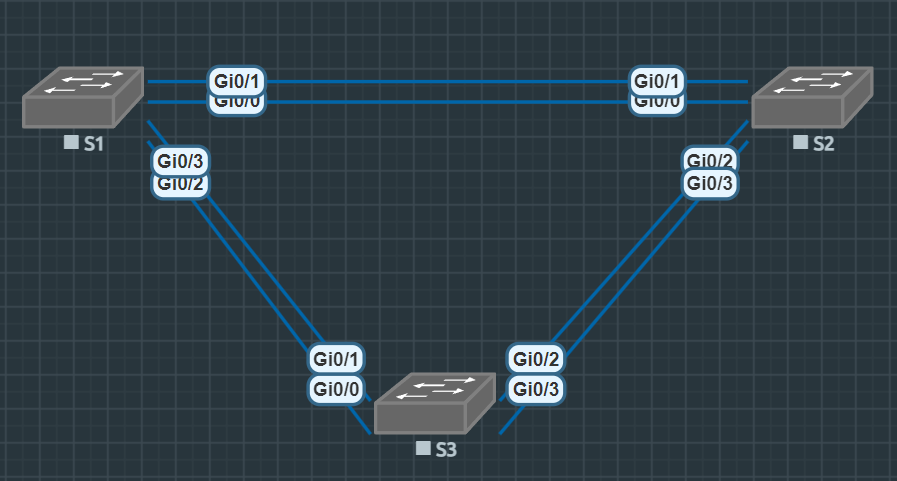

# Лабораторная работа. Развертывание коммутируемой сети с резервными каналами

## Топология


## Таблица адресации

| Устройство | Интерфейс | IP-адрес | Маска подсети |
|---|---|---|---|
| S1 | VLAN 1 | 192.168.1.1 | 255.255.255.0 |
| S2 | VLAN 1 | 192.168.1.2 | 255.255.255.0 |
| S3 | VLAN 1 | 192.168.1.3 | 255.255.255.0 |

## Цели:

* Часть 1. [Создание сети и настройка основных параметров устройства](#создание-сети-и-настройка-основных-параметров-устройства)
* Часть 2. [Выбор корневого моста](#выбор-корневого-моста)
* Часть 3. [Наблюдение за процессом выбора протоколом STP порта, исходя из стоимости портов](#наблюдение-за-процессом-выбора-протоколом-stp-порта-исходя-из-стоимости-портов)
* Часть 4. [Наблюдение за процессом выбора протоколом STP порта, исходя из приоритета портов](#наблюдение-за-процессом-выбора-протоколом-stp-порта-исходя-из-приоритета-портов)

## Создание сети и настройка основных параметров устройства

#### Настройте базовые параметры каждого коммутатора
На примере скрипта ниже был настроен каждый коммутатор, с изменением имени хоста и ip адреса.
```bash
Switch>enable
Switch#conf t
Switch(config)#no ip domain-lookup
Switch(config)#hostname S1
S1(config)#enable secret class
S1(config)#line console 0
S1(config-line)#password cisco
S1(config-line)#login
S1(config-line)#logging synchronous
S1(config-line)#exit
S1(config)#line vty 0 4
S1(config-line)#password cisco
S1(config-line)#login
S1(config-line)#logging synchronous
S1(config-line)#exit
S1(config)#service password-encryption
S1(config)#banner motd @Authorized access only!@
S1(config)#int vlan 1
S1(config-if)#ip address 192.168.1.1 255.255.255.0
S1(config-if)#no sh
S1(config-if)#exit
S1(config)#do copy run start
```
Проверка связности
```bash
=== S1 -> S2 ===

S1#ping 192.168.1.2
Type escape sequence to abort.
Sending 5, 100-byte ICMP Echos to 192.168.1.2, timeout is 2 seconds:
!!!!!

=== S1 -> S3 ===
S1#ping 192.168.1.3
Type escape sequence to abort.
Sending 5, 100-byte ICMP Echos to 192.168.1.3, timeout is 2 seconds:
!!!!!

=== S2 -> S3 ===
S2#ping 192.168.1.3
Type escape sequence to abort.
Sending 5, 100-byte ICMP Echos to 192.168.1.3, timeout is 2 seconds:
!!!!!
```

## Выбор корневого моста
Отключите все порты на коммутаторах
```bash
int range gi0/0 - 3, gi1/0 - 1
```
Настройте подключенные порты в качестве транковых, включите gi0/3 и gi0/0. 
```bash
int range gi0/0-3
    switchport trunk encapsulation dot1q
    switchport mode trunk
    exit
int gi0/1
    no sh
    exit
int gi0/3
    no sh
    exit
```
Отобразите данные протокола spanning-tree

```bash
S1#show spanning-tree

VLAN0001
  Spanning tree enabled protocol rstp
  Root ID    Priority    32769
             Address     5000.0001.0000
             This bridge is the root
             Hello Time   2 sec  Max Age 20 sec  Forward Delay 15 sec

  Bridge ID  Priority    32769  (priority 32768 sys-id-ext 1)
             Address     5000.0001.0000
             Hello Time   2 sec  Max Age 20 sec  Forward Delay 15 sec
             Aging Time  300 sec

Interface           Role Sts Cost      Prio.Nbr Type
------------------- ---- --- --------- -------- --------------------------------
Gi0/1               Desg FWD 4         128.2    Shr
Gi0/3               Desg FWD 4         128.4    Shr

S2#show spanning-tree

VLAN0001
  Spanning tree enabled protocol rstp
  Root ID    Priority    32769
             Address     5000.0001.0000
             Cost        4
             Port        2 (GigabitEthernet0/1)
             Hello Time   2 sec  Max Age 20 sec  Forward Delay 15 sec

  Bridge ID  Priority    32769  (priority 32768 sys-id-ext 1)
             Address     5000.0002.0000
             Hello Time   2 sec  Max Age 20 sec  Forward Delay 15 sec
             Aging Time  300 sec

Interface           Role Sts Cost      Prio.Nbr Type
------------------- ---- --- --------- -------- --------------------------------
Gi0/1               Root FWD 4         128.2    Shr
Gi0/3               Desg FWD 4         128.4    Shr

S3#show spanning-tree

VLAN0001
  Spanning tree enabled protocol rstp
  Root ID    Priority    32769
             Address     5000.0001.0000
             Cost        4
             Port        2 (GigabitEthernet0/1)
             Hello Time   2 sec  Max Age 20 sec  Forward Delay 15 sec

  Bridge ID  Priority    32769  (priority 32768 sys-id-ext 1)
             Address     5000.0003.0000
             Hello Time   2 sec  Max Age 20 sec  Forward Delay 15 sec
             Aging Time  300 sec

Interface           Role Sts Cost      Prio.Nbr Type
------------------- ---- --- --------- -------- --------------------------------
Gi0/1               Root FWD 4         128.2    Shr
Gi0/3               Altn BLK 4         128.4    Shr

```

- Какой коммутатор является корневым мостом?
    - S1. Сообщение в root id указывает "This bridge is the root"
- Почему этот коммутатор был выбран протоколом spanning-tree в качестве корневого моста?
    - У всех коммутаторов одинаковый priority и cost портов, но S1 имеет самый маленький мак, он и стал корневым.
- Какие порты на коммутаторе являются корневыми портами?
    - На S1? (Не конкретизируется какой коммутатор имеется в виду) На корневом мосте S1 корневых портов нет.
- Какие порты на коммутаторе являются назначенными портами?
    Все порты на S1 + Gi0/3 на S2.
- Какой порт отображается в качестве альтернативного и в настоящее время заблокирован?
    - На S3 заблокирован порт gi0/3.
    Gi0/3               Altn **BLK** 4         128.4    Shr
- Почему протокол spanning-tree выбрал этот порт в качестве невыделенного (заблокированного) порта?
    - В сегменте сети S2 и S3 был выбран Gi0/3 на S2 назначенным, потому что при одинаковом priority и cost (все порты гигобитные) сравниваются уже маки, а мак адрес S2 < S3.