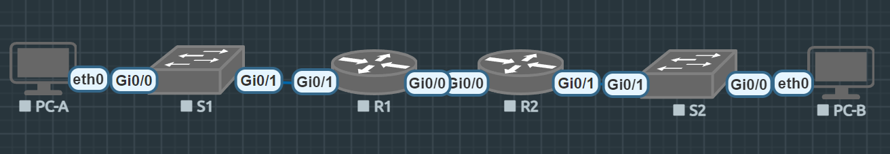

# Лабораторная работа - Реализация DHCPv4
## 
## Таблица адресации

| Устройство | Интерфейс | IP-адрес | Маска подсети | Шлюз по умолчанию |
|---|---|---|---|---|
| R1 | Gi0/0 | 10.0.0.1 | 255.255.255.252 | — |
| R1 | Gi0/1 | — | — | — |
| R1 | Gi0/1.100 | 192.168.1.1| 255.255.255.192 | — |
| R1 | Gi0/1.200 | 192.168.1.65 | 255.255.255.224 | — |
| R1 | Gi0/1.1000 | — | — | — |
| R2 | Gi0/0 | 10.0.0.2 | 255.255.255.252 | — |
| R2 | Gi0/1 | 192.168.1.97 | 255.255.255.240 | — |
| S1 | VLAN 200 | 192.168.1.66 | 255.255.255.224 |  |
| S2 | VLAN 1 | 192.168.1.98  | 255.255.255.240 |  |
| PC-A | NIC | DHCP | DHCP | DHCP |
| PC-B | NIC | DHCP | DHCP | DHCP |

## Таблица VLAN

| VLAN | Имя | Назначенный интерфейс |
|---|---|---|
| 1 | Нет | S2: Gi0/0 |
| 100 | Clients | S1: Gi0/1 |
| 200 | Managment | S1: VLAN 200 |
| 999 | Parking_Lot | - |
| 1000 | Native | — |

## Задачи:

* Часть 1. [Создание сети и настройка основных параметров устройства](#создание-сети-и-настройка-основных-параметров-устройства)
* Часть 2. [Настройка и проверка двух серверов DHCPv4 на R1](#настройка-и-проверка-двух-серверов-dhcpv4-на-r1)
* Часть 3. [Настройка и проверка DHCP-ретрансляции на 
R2](#настройка-и-проверка-dhcp-ретрансляции-на-r2)

## Создание сети и настройка основных параметров устройства
### Создание схемы адресации
Формула для определения кол-во хостов: 2^n − 2 ≥ требуемое число хостов
Подсеть сети 192.168.1.0/24 в соответствии со следующими требованиями:
Одна подсеть «Подсеть A», поддерживающая 58 хостов (клиентская VLAN на R1).
**Подсеть A**
Кол-во хостов: 2^6 − 2 = 62 > 58
Префикс: в одном октете 8 бит. 8 - 6 = 2. 24 + 2 = 26. Префикс будет 26
Маска. 256 - 2^6 = 192. 255.255.255.192
Диапазон:  192.168.1.0 – 192.168.1.63
**Подсеть B**
Одна подсеть «Подсеть B», поддерживающая 28 хостов (управляющая VLAN на R1). 
Кол-во хостов: 2^5 - 2 = 30 > 28
Префикс: /27
Маска: 255.255.255.224
Диапазон: 192.168.1.64 - 192.168.1.95
**Подсеть С**
Одна подсеть «Подсеть C», поддерживающая 12 узлов (клиентская сеть на R2).
Кол-во хостов: 2^4 - 2 = 14 > 28 
Префикс: /28
Маска: 255.255.255.240
Диапазон: 192.168.1.96 - 192.168.1.111

### Создайте сеть согласно топологии и произведите базовую настройку маршрутизаторов

```bash
enable
conf t
no ip domain-lookup
hostname R1
enable secret class
line console 0
password cisco
login
logging synchronous
exit
line vty 0 4
password cisco
login
logging synchronous
exit
service password-encryption
banner motd @Authorized access only!@
do copy run start
clock set 19:12:00 26 October 2026
```
#### Настройка маршрутизации между сетями VLAN на маршрутизаторе R1
```bash
int gi0/1
    no sh
    exit
int gi0/1.100
    description Client vlan 100 - Subnet A
    encapsulation dot1Q 100
    ip address 192.168.1.1 255.255.255.192
    exit
int gi0/1.200
    description Management vlan 200 - Subnet B
    encapsulation dot1Q 200
    ip address 192.168.1.65 255.255.255.224
    exit
int gi0/1.1000
    description Native vlan 1000
    encapsulation dot1Q 1000 native
    exit
```
#### Настройте G0/1 на R2, затем G0/0/0 и статическую маршрутизацию для обоих маршрутизаторов

```bash
=== НА R2 ===
int gi0/1
    ip address 192.168.1.97 255.255.255.240
    no sh
    exit
int gi0/0
    ip address 10.0.0.2 255.255.255.252
    no sh
    exit
ip route 0.0.0.0 0.0.0.0 10.0.0.1
exit

=== Так же был подключен gi0/0 на R1 и статическая маршуртизация ===

# Проверка связности

R1#ping 192.168.1.97
Type escape sequence to abort.
Sending 5, 100-byte ICMP Echos to 192.168.1.97, timeout is 2 seconds:
!!!!!
Success rate is 100 percent (5/5), round-trip min/avg/max = 4/5/8 ms

R2#ping 192.168.1.1
Type escape sequence to abort.
Sending 5, 100-byte ICMP Echos to 192.168.1.1, timeout is 2 seconds:
!!!!!
Success rate is 100 percent (5/5), round-trip min/avg/max = 3/5/7 ms
Success rate is 0 percent (0/5)

R2#ping 192.168.1.65
Type escape sequence to abort.
Sending 5, 100-byte ICMP Echos to 192.168.1.65, timeout is 2 seconds:
!!!!!
Success rate is 100 percent (5/5), round-trip min/avg/max = 3/5/9 ms
```
#### Настройте базовые параметры каждого коммутатора

```bash
enable
conf t
no ip domain-lookup
hostname S1
enable secret class
line console 0
password cisco
login
logging synchronous
exit
line vty 0 4
password cisco
login
logging synchronous
exit
service password-encryption
banner motd @Authorized access only!@
do copy run start
clock set 20:00:00 26 October 2026
```

#### Создайте сети VLAN на коммутаторе S1

```bash
vlan 100
    name Clients
    exit
vlan 200
    name Management
    exit
vlan 999
    name Parking_Lot
    exit
vlan 1000
    name Native
    exit

=== S1 ===

int vlan 200
ip address 192.168.1.66 255.255.255.224
no sh
exit
no ip routing
ip default-gateway 192.168.1.65

=== S2 ===
int vlan 1
ip address 192.168.1.98 255.255.255.240
no sh
exit
no ip routing
ip default-gateway 192.168.1.97

# Так как было создано всего по 2 физических интерфейса на всех оборудованиях - отправлять в parking_lot нечего
```

#### Назначьте сети VLAN соответствующим интерфейсам коммутатора

```bash
=== S1 ===
int gi0/0
    sw mode access
    sw access vlan 100
    no sh
    exit

=== S2 ===

int gi0/0
    sw mode access
    sw access vlan 1
    no sh
    exit
```
- Почему интерфейс F0/5 указан в VLAN 1?
    - В моем случае это gi0/1. Изначально все порты попадают в ~~рай~~ vlan1. Но мы это граммотно исправили)

#### Вручную настройте интерфейс S1 Gi0/1 в качестве транка 802.1Q

```bash
int gi0/1
    switchport trunk encapsulation dot1q
    switchport mode trunk
    switchport trunk allowed vlan 100,200,1000
    switchport trunk native vlan 1000
    no sh
    exit
```
- Какой IP-адрес был бы у ПК, если бы он был подключен к сети с помощью DHCP?
    - PC-A получит первый свободный из пула адресов ip.

## Настройка и проверка двух серверов DHCPv4 на R1
#### Настройте R1 с пулами DHCPv4 для двух поддерживаемых подсетей.
R1 sub_nwrk_A

```bash
ip dhcp pool VLAN100_Pool
    network 192.168.1.0 255.255.255.192
    domain-name CCNA-lab.com
    default-router 192.168.1.1
    lease 2 12 30
    exit
ip dhcp excluded-address 192.168.1.1 192.168.1.5
```
R1 sub_nwrk_C

```bash
ip dhcp pool R2_Client_LAN
    network 192.168.1.96 255.255.255.240
    domain-name CCNA-lab.com
    default-router 192.168.1.97
    lease 2 12 30
    exit
ip dhcp excluded-address 192.168.1.97 192.168.1.101
```
#### Проверка конфигурации сервера DHCPv4

```bash
R1(config)#do show ip dhcp pool

Pool VLAN100_Pool :
 Utilization mark (high/low)    : 100 / 0
 Subnet size (first/next)       : 0 / 0
 Total addresses                : 62
 Leased addresses               : 0
 Pending event                  : none
 1 subnet is currently in the pool :
 Current index        IP address range                    Leased addresses
 192.168.1.1          192.168.1.1      - 192.168.1.62      0

Pool R2_Client_LAN :
 Utilization mark (high/low)    : 100 / 0
 Subnet size (first/next)       : 0 / 0
 Total addresses                : 14
 Leased addresses               : 0
 Pending event                  : none
 1 subnet is currently in the pool :
 Current index        IP address range                    Leased addresses
 192.168.1.97         192.168.1.97     - 192.168.1.110     0

```
#### Попытка получить IP-адрес от DHCP на PC-A

```bash
VPCS> ip dhcp
DDORA IP 192.168.1.6/26 GW 192.168.1.1


VPCS> show ip

NAME        : VPCS[1]
IP/MASK     : 192.168.1.6/26
GATEWAY     : 192.168.1.1
DNS         :
DHCP SERVER : 192.168.1.1
DHCP LEASE  : 217767, 217800/108900/190575
DOMAIN NAME : CCNA-lab.com
MAC         : 00:50:79:66:68:01
LPORT       : 20000
RHOST:PORT  : 127.0.0.1:30000
MTU         : 1500


VPCS> ping 192.168.1.1

84 bytes from 192.168.1.1 icmp_seq=1 ttl=255 time=5.778 ms
84 bytes from 192.168.1.1 icmp_seq=2 ttl=255 time=5.132 ms
84 bytes from 192.168.1.1 icmp_seq=3 ttl=255 time=5.746 ms
84 bytes from 192.168.1.1 icmp_seq=4 ttl=255 time=5.630 ms
84 bytes from 192.168.1.1 icmp_seq=5 ttl=255 time=4.874 ms
^C
```

## Настройка и проверка DHCP-ретрансляции на R2

```bash
interface gi0/1
    ip helper-address 10.0.0.1
    exit
```
```bash
VPCS> ip dhcp
DDORA IP 192.168.1.102/28 GW 192.168.1.97

VPCS> show ip

NAME        : VPCS[1]
IP/MASK     : 192.168.1.102/28
GATEWAY     : 192.168.1.97
DNS         :
DHCP SERVER : 10.0.0.1
DHCP LEASE  : 217793, 217800/108900/190575
DOMAIN NAME : CCNA-lab.com
MAC         : 00:50:79:66:68:02
LPORT       : 20000
RHOST:PORT  : 127.0.0.1:30000
MTU         : 1500

VPCS> ping 192.168.1.6

84 bytes from 192.168.1.6 icmp_seq=1 ttl=62 time=20.321 ms
84 bytes from 192.168.1.6 icmp_seq=2 ttl=62 time=14.505 ms
84 bytes from 192.168.1.6 icmp_seq=3 ttl=62 time=12.131 ms
84 bytes from 192.168.1.6 icmp_seq=4 ttl=62 time=10.526 ms
84 bytes from 192.168.1.6 icmp_seq=5 ttl=62 time=12.692 ms
^C
```
```bash
R1# show ip dhcp binding
Bindings from all pools not associated with VRF:
IP address          Client-ID/              Lease expiration        Type
                    Hardware address/
                    User name
192.168.1.6         0100.5079.6668.01       Oct 29 2026 08:03 AM    Automatic
192.168.1.102       0100.5079.6668.02       Oct 29 2026 08:11 AM    Automatic
R1#show ip dhcp server statistics
Memory usage         66764
Address pools        2
Database agents      0
Automatic bindings   2
Manual bindings      0
Expired bindings     1
Malformed messages   0
Secure arp entries   0

Message              Received
BOOTREQUEST          0
DHCPDISCOVER         12
DHCPREQUEST          5
DHCPDECLINE          0
DHCPRELEASE          0
DHCPINFORM           0

Message              Sent
BOOTREPLY            0
DHCPOFFER            6
DHCPACK              5
DHCPNAK              0
```
**Примечание:** при первичной настройке я забыла исключить первые пять адресов из пулов DHCP. Из-за этого сервер пытался выдать уже занятые адреса, возникали конфликты. Поэтому счётчики в статистике DHCP примерно вдвое больше реального числа клиентов.